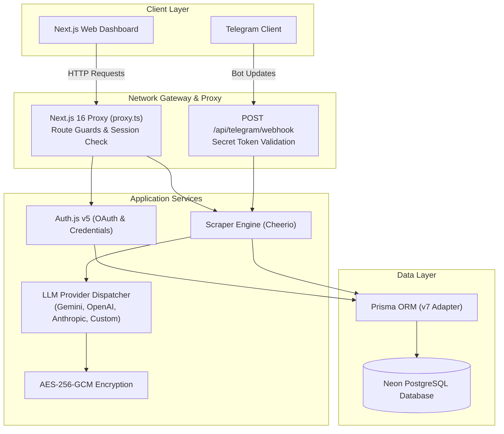
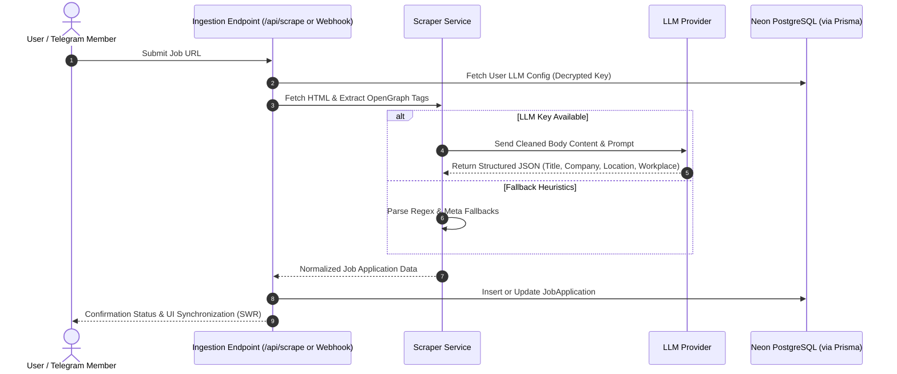
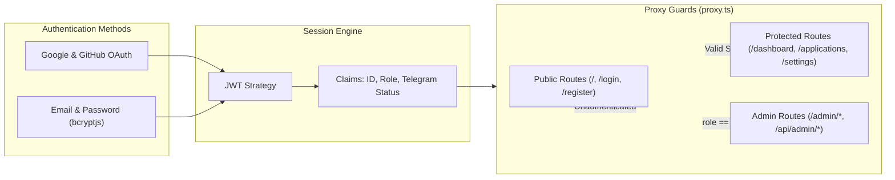
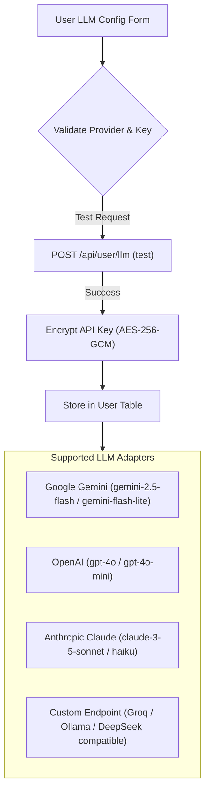

<!-- BEGIN:nextjs-agent-rules -->

## This is NOT the Next.js you know

This version has breaking changes — APIs, conventions, and file structure may all differ from your training data. Read the relevant guide in `node_modules/next/dist/docs/` (resolved from this file's directory; in monorepos the `next` package may not be visible from the repo root) before writing any code. Heed deprecation notices.

This block is written and re-added by `next dev` — verify at `node_modules/next/dist/server/lib/generate-agent-files.js`. Removing it from a diff only re-creates the uncommitted change; committing it with your work keeps the tree clean.

<!-- END:nextjs-agent-rules -->

# CareerHub — System Architecture & Engineering Reference (AGENTS.md)

[](src/proxy.ts)
[](prisma/schema.prisma)
[](src/lib/encryption.ts)

This document is the permanent architectural reference, design specification, and engineering standard for CareerHub. All code modifications, API additions, and UI updates must adhere to the rules outlined here.

---

## 1. Core Engineering Rules & Constraints

1. **Max Lines per File**: No file must exceed **350 lines of code**. Large components or handlers must be modularized into domain hooks, utilities, or subcomponents.
2. **Clean Code**:
   - Zero unused imports or variables.
   - Strictly typed TypeScript without untyped escapes.
   - No commented-out dead code or speculative stubs.
   - No emojis anywhere: not in code, UI text, commit messages, or documentation. Use clean SVG vector icons (e.g., `lucide-react`).
3. **UI Edge Styling**:
   - Component edges must be **near-sharp**: maximum border-radius of **2px to 3px** (`rounded-xs`).
   - Heavy rounded corners (`rounded-lg`, `rounded-xl`, `rounded-full`) are strictly prohibited.
4. **Color Theme**:
   - Primary Accent: TypeScript Blue (`#3178C6`).
   - Primary Hover: `#235A97`.
   - Subtle Accent Tint: `rgba(49, 120, 198, 0.12)`.
   - Dark Slate Aesthetic: Background `#0A0D12`, Surface `#12171F`, Border `#202937`.

---

## 2. High-Level Architecture Overview

CareerHub is a full-stack Next.js application that centralizes, parses, and manages career opportunities through web interactions, direct URL scraping, and Telegram bot webhooks.



---

## 3. Ingestion & Extraction Workflow

Job URLs ingested through manual input or Telegram messages undergo metadata parsing and LLM structured extraction before being committed to the user pipeline.



---

## 4. Authentication & Security Model



### Session User Interface

```typescript
interface SessionUser {
  id: string;
  email: string;
  name?: string | null;
  image?: string | null;
  role: "USER" | "ADMIN";
  telegramConnected: boolean;
}
```

---

## 5. Multi-Provider AI Architecture

Users can configure their own LLM providers for parsing job postings, reducing reliance on global quotas and improving domain accuracy.



### Encryption Specification

- **Algorithm**: `aes-256-gcm` authenticated encryption.
- **Key Derivation**: SHA-256 digest derived from `AUTH_SECRET`.
- **Payload Format**: `enc:v1:<iv_hex>:<auth_tag_hex>:<ciphertext_hex>`.
- Plaintext API keys are never stored in the database or exposed via API responses. Responses return only masked hints (e.g., `sk-ant...a91c`).

---

## 6. Real-Time State Management (SWR)

- **Global SWR Cache**: Application records, Telegram status, and metrics use SWR for cache invalidation and window focus revalidation.
- **Telegram Hook (`useTelegramStatus`)**: Ensures navigation badges, dashboard action cards, and pairing modals update synchronously across browser tabs and webhook completions.
- **Optimistic Pipeline Actions**: Kanban column moves and table status toggles execute immediate UI mutations with automatic rollback on server error.

---

## 7. Database Specification & Schema Models

### Key Entities

1. **User**:
   - `id`: UUID (Primary Key).
   - `email`: String (Unique).
   - `passwordHash`: String (Optional, for credentials auth).
   - `role`: Role (`USER` | `ADMIN`, default `USER`).
   - `telegramChatId`: String (Unique, nullable).
   - `telegramPairToken`: String (Unique, nullable).
   - `llmProvider`: String (Default `"GEMINI"`).
   - `llmApiKeyHash`: Text (AES-256-GCM ciphertext).
   - `llmEndpoint`: String (Custom OpenAI-compatible base URL).
   - `llmModel`: String (Selected model identifier).
2. **JobApplication**:
   - `id`: UUID.
   - `userId`: Foreign Key -> `User.id`.
   - `companyName`: String.
   - `jobTitle`: String.
   - `location`: String (Nullable).
   - `locationType`: `REMOTE` | `HYBRID` | `ONSITE`.
   - `employmentType`: `FULL_TIME` | `PART_TIME` | `CONTRACT` | `INTERNSHIP`.
   - `salaryMin`, `salaryMax`, `currency`: Decimal compensation ranges.
   - `jobUrl`, `jobDescription`: Original posting details.
   - `source`: `MANUAL` | `TELEGRAM` | `LINK_SCRAPER` | `LINKEDIN` | `OTHER`.
   - `status`: `WISHLIST` | `APPLIED` | `SCREENING` | `INTERVIEW` | `OFFER` | `REJECTED` | `WITHDRAWN`.
   - `appliedDate`, `deadline`: Temporal tracking.
3. **ApplicationActivity**:
   - Audit trail capturing status transitions, note additions, and interaction timestamps.

---

## 8. Deployment & Operational Checklist

1. **Environment Variables**:
   - `DATABASE_URL`: Neon PostgreSQL pooled connection URL.
   - `AUTH_SECRET`: Secret key for session signing and API key encryption (`openssl rand -base64 32`).
   - `NEXTAUTH_URL`: Canonical production domain URL.
   - `GOOGLE_CLIENT_ID` & `GOOGLE_CLIENT_SECRET`.
   - `GITHUB_CLIENT_ID` & `GITHUB_CLIENT_SECRET`.
   - `TELEGRAM_BOT_TOKEN`: Bot token generated via BotFather.
   - `TELEGRAM_WEBHOOK_SECRET`: Token passed in `X-Telegram-Bot-Api-Secret-Token`.
2. **Build Configuration**:
   - Command: `prisma generate && next build`.
   - Proxy convention: `src/proxy.ts` (Next.js 16 standard).
3. **Database Migration**:
   - Schema synchronization: `npx prisma db push` or `npx prisma migrate deploy`.
